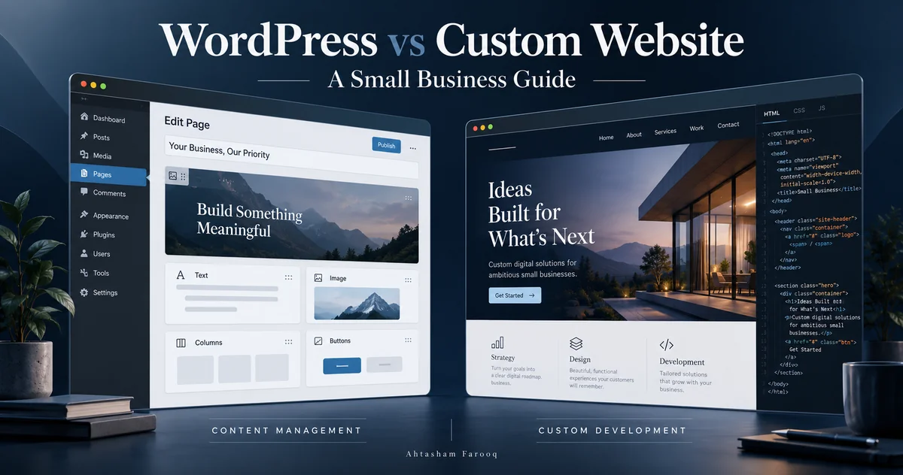

# WordPress vs Custom Website for a Small Business

*Illustrative comparison; not screenshots of client projects.*

Choose WordPress when your business needs familiar content editing and features that established themes and plugins can support. Consider a custom-coded website when your requirements call for a purpose-built interface or workflow, or when a small, rarely updated site can be delivered more simply without a CMS. The useful comparison is what you need to manage, what visitors need to do, and who will maintain it after launch.

Start with one distinction: a WordPress website can also be custom-designed. Here, “custom website” means a custom-coded implementation rather than a WordPress-based site. It may still use a separate content management system. This guide compares those approaches, not template design against good design.

## The quick comparison

| Decision | WordPress-based website | Custom-coded website |
| --- | --- | --- |
| Updating content | An established editor for pages and posts | An editor must be included, or updates may require a developer |
| Common features | Existing plugins may cover forms, booking and commerce | Integrate a service or build the required feature |
| Specialized workflows | May need custom plugin work and integration testing | Can be designed around the workflow from the start |
| Initial cost | Depends on design, plugins, integrations and migration | Depends on scope; a simple static site differs greatly from a web application |
| Ongoing work | Hosting, backups, core/theme/plugin updates and testing | Hosting, dependencies, integrations and application maintenance as applicable |
| Performance and SEO | Depend on implementation and content | Also depend on implementation and content |

## Start with who will update the website

If your team publishes articles, changes service descriptions or adds products regularly, the editing experience matters as much as the public design. Ask to see how those tasks work before choosing a platform.

WordPress is a sensible option to evaluate when you want an established publishing workflow. A custom-coded site can offer editing too, but the quote should explicitly include the CMS, editable fields, permissions and handover.

For a five-page consultancy site that changes twice a year, a lightweight custom build may be practical. For a team publishing weekly, making every text change a development request could create unnecessary friction. Neither scenario needs an elaborate dashboard unless there is a real reason for one.

## Compare the full scope, not just the build price

Two website quotes are only comparable when they cover the same work. A low quote might omit content entry, mobile testing, redirects or ongoing support. A higher quote may include those items, or may describe a larger project than you need.

Ask each developer to separate:

1. Design and development, including revisions.
2. Content preparation and migration.
3. Hosting, domain and paid software renewals.
4. Integrations, such as booking, payments or CRM connections.
5. Maintenance, backups and support.
6. Ownership, handover and future change requests.

Compare the first year and a typical following year. Treat any estimate as scope-specific. A brochure website, an online shop and a customer portal should not share a single “small business website” price.

If you need help defining that scope, explore my [web development services](/web-development.html).

## Match the technology to the workflow

Consider a local service business that needs service pages, a contact form and a booking link. WordPress with a carefully selected integration may meet those requirements. Building a booking engine from scratch would need a clear business justification.

Now consider a business whose customers must submit documents, receive role-based approvals and track a personalized workflow. A custom application may give more control over that experience. WordPress could still be considered, but compare the actual implementation and maintenance requirements rather than assuming plugins will handle every detail.

These are illustrative scenarios, not claims about specific client projects. Before deciding, list the actions users must complete and the systems those actions depend on.

## Which option is better for SEO and speed?

A platform choice alone does not establish how useful, crawlable or fast the finished website will be. For either approach, ask for clear page titles, readable content, internal links, accessible navigation, image optimization and appropriate indexing controls. Google's [SEO Starter Guide](https://developers.google.com/search/docs/fundamentals/seo-starter-guide) explains these foundations.

For performance, review representative pages on mobile, not only an empty demo. Large media, unnecessary scripts and third-party integrations are worth checking in either build. A custom-coded site can be heavy, and a carefully implemented WordPress site can be lightweight.

Ask what will be measured before launch and how problems will be fixed. Avoid choosing on promises that a particular platform will automatically put your business first in search.

## Who maintains it after launch?

WordPress maintenance includes keeping core software, themes and plugins current. WordPress's documentation explains [plugin and theme updates](https://wordpress.org/documentation/article/plugins-themes-auto-updates/) and [updating WordPress itself](https://wordpress.org/documentation/article/updating-wordpress/). Agree who handles backups and checks important flows after changes.

A custom build also needs a maintenance plan. The work depends on its architecture: a static information site has different requirements from an application with accounts, payments and stored customer data. Ask who handles dependency updates, service changes, monitoring and recovery.

Whichever option you choose, confirm ownership of the domain, hosting accounts, source code and relevant licenses. Request documented access and a practical handover so you understand how to operate the site.

## A five-question decision checklist

- Who edits the content, and how often?
- Which features are standard, and which are specific to your business?
- What must connect to your existing tools?
- What can you budget for both launch and ongoing upkeep?
- Who will support the website after delivery?

If regular publishing and established features dominate, start by evaluating [WordPress development](/wordpress-development.html). If the interface or business workflow needs a tailored implementation, compare a custom build against a WordPress-based proposal using the same written requirements.

## Common questions

### Can a WordPress website have a unique design?

Yes. WordPress does not require every website to use an unchanged off-the-shelf design. Discuss whether the proposal uses a configured theme, custom theme work or another agreed design approach, and what that means for editing and maintenance.

### Does a custom website need a developer for every update?

Not necessarily. It can include a CMS or other editing tools. Those capabilities need to be part of the scope; “custom” does not tell you what the owner can edit.

### Can I change platforms later?

A migration can be planned, but content, media, integrations, URLs and redirects need attention. Include migration requirements in the proposal instead of assuming everything will transfer unchanged.

## Choose the setup you can run comfortably

Write down your required pages, editing needs, integrations and launch priorities. Compare proposals against that list, including the responsibilities after launch. The right solution should fit the way your business operates and leave you with a website you can maintain.

I'm Ahtasham Farooq, a software engineer and full stack developer based in Bahawalpur, Pakistan, working with remote clients internationally. [Tell me about your website](/index.html#contact), and we can discuss the requirements before choosing an implementation.
